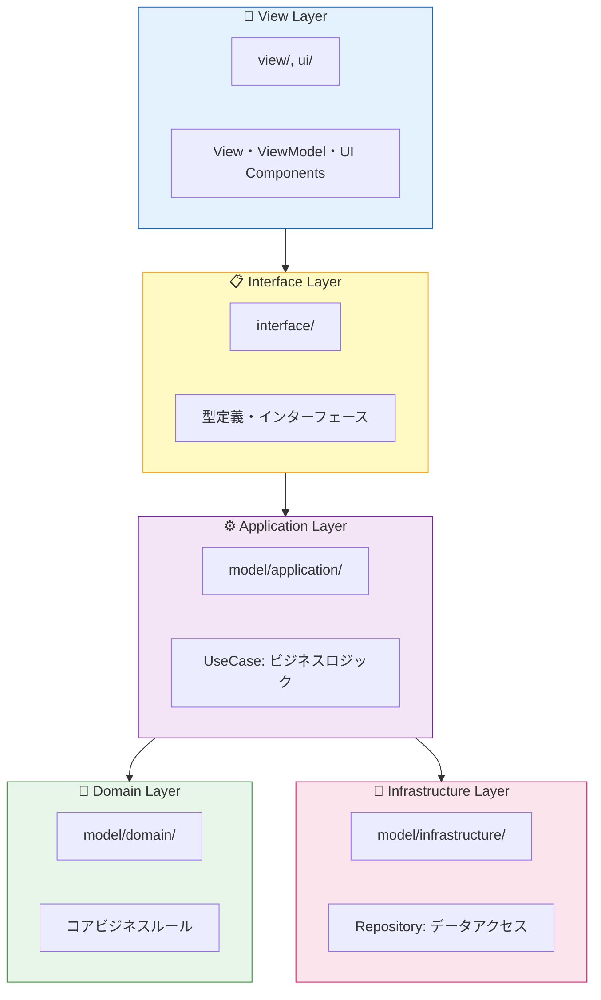

# Next2D Framework TypeScript Template

[Create Next2D App](https://github.com/Next2D/create-next2d-app) でブートストラップされたプロジェクトです。

This project was bootstrapped with [Create Next2D App](https://github.com/Next2D/create-next2d-app).

---

## 目次 / Table of Contents

- [必要な環境 / Requirements](#必要な環境--requirements)
- [セットアップ / Setup](#セットアップ--setup)
- [アーキテクチャ / Architecture](#アーキテクチャ--architecture)
- [開発サーバー / Development Server](#開発サーバー--development-server)
- [コード生成 / Code Generation](#コード生成--code-generation)
- [プラットフォームエミュレーター / Platform Emulators](#プラットフォームエミュレーター--platform-emulators)
- [ユニットテスト / Unit Test](#ユニットテスト--unit-test)
- [ビルド / Build](#ビルド--build)
- [ディレクトリ構成 / Directory Structure](#ディレクトリ構成--directory-structure)
- [📚 詳細ドキュメント / Detailed Documentation](#-詳細ドキュメント--detailed-documentation)
- [ライセンス / License](#ライセンス--license)

---

## 必要な環境 / Requirements

| ツール / Tool | バージョン / Version |
|--------------|---------------------|
| Node.js | 22.12 以上 / 22.12 or higher |
| npm | 10.x 以上 / 10.x or higher |

### オプション / Optional

iOS/Androidビルドを行う場合は、以下も必要です。

For iOS/Android builds, the following are also required:

- **iOS**: Xcode 14 以上、macOS
- **Android**: Android Studio、JDK 21 以上
- **Xbox (試作 / prototype)**: Windows、Visual Studio 2022、Microsoft GDK、CMake 3.26 以上

---

## セットアップ / Setup

### 1. リポジトリのクローン / Clone the repository

```bash
git clone <repository-url>
cd <project-directory>
```

### 2. 依存パッケージのインストール / Install dependencies

```bash
npm install
```

### 3. 開発サーバーの起動 / Start the development server

```bash
npm start
```

ブラウザで [http://localhost:5173](http://localhost:5173) を開いてください。

Open [http://localhost:5173](http://localhost:5173) in your browser.

---

## アーキテクチャ / Architecture

このプロジェクトは **MVVM + Clean Architecture + Atomic Design** を採用しています。

This project adopts **MVVM + Clean Architecture + Atomic Design**.



詳細は [ARCHITECTURE.md](./ARCHITECTURE.md) を参照してください。

See [ARCHITECTURE.md](./ARCHITECTURE.md) for details.

---

## 開発サーバー / Development Server

### `npm start`

開発モードでアプリケーションを起動します。  
[http://localhost:5173](http://localhost:5173) をブラウザで開いてください。  
コードを変更すると自動的にリロードされます。

Runs the app in development mode.  
Open [http://localhost:5173](http://localhost:5173) to view it in your browser.  
The page will reload when you make changes.

---

## コード生成 / Code Generation

### `npm run generate`

`routing.json` の設定に基づいて、必要な View と ViewModel クラスを自動生成します。  
新しい画面を追加する際に便利です。

Generates the necessary View and ViewModel classes from the `routing.json` file.  
Useful when adding new screens.

---

## プラットフォームエミュレーター / Platform Emulators

各プラットフォーム向けのエミュレーターを起動します。  
`--env` オプションで環境を指定できます（`dev`, `stg`, `prd` など）。

Launch emulators for each platform.  
You can specify the environment with the `--env` option (`dev`, `stg`, `prd`, etc.).

| コマンド / Command | プラットフォーム / Platform |
|-------------------|---------------------------|
| `npm run preview:web` | Web (HTML) |
| `npm run preview:windows` | Windows |
| `npm run preview:macos` | macOS |
| `npm run preview:linux` | Linux |
| `npm run preview:ios` | iOS |
| `npm run preview:android` | Android |

---

## ユニットテスト / Unit Test

### `npm test`

Vitest を使用してテストを実行します。

Runs tests using Vitest.

```bash
# 全テスト実行 / Run all tests
npm test

# ウォッチモード / Watch mode
npm test -- --watch

# カバレッジレポート / Coverage report
npm test -- --coverage
```

---

## ビルド / Build

各プラットフォーム向けにビルドを行います。  
`--env` オプションで環境を指定できます。

Build for each platform.  
You can specify the environment with the `--env` option.

| コマンド / Command | プラットフォーム / Platform | 出力先 / Output |
|-------------------|---------------------------|----------------|
| `npm run build:web` | Web (HTML) | `dist/web/prd/` |
| `npm run build:steam:windows` | Windows (Steam) | `dist/steam/windows/build/prd/` |
| `npm run build:steam:macos` | macOS (Steam) | `dist/steam/macos/build/prd/` |
| `npm run build:steam:linux` | Linux (Steam) | `dist/steam/linux/build/prd/` |
| `npm run build:steam:manifest` | Steam 共有Depot / Shared depot | `dist/steam/shared/prd/` |
| `npm run build:ios` | iOS | `ios/` (Xcode) |
| `npm run build:android` | Android | `android/` (Android Studio) |
| `npm run build:xbox` | Xbox (試作 / prototype) | `xbox/` (GDK host) |

各スクリプトの既定環境は `prd` です。別の環境は `npm run build:web -- --env dev` のように上書きします。

Each script defaults to the `prd` environment. Override it like `npm run build:web -- --env dev`.

### Steam アップロード / Steam upload

```bash
npm run upload:steam:dry-run   # ローカル検証のみ / Local validation only
npm run upload:steam           # 全OSの成果物をSteamPipeへアップロード / Upload all OS packages
```

`electron.config.json` の `steam.appId` / `steam.depots` と、環境変数 `STEAM_USERNAME`（任意で `STEAMCMD`）が必要です。

Requires `steam.appId` / `steam.depots` in `electron.config.json` and the `STEAM_USERNAME` (optionally `STEAMCMD`) environment variable.

### 環境設定 / Environment Configuration

環境ごとの設定は `src/config/` ディレクトリで管理されています。

Environment-specific settings are managed in the `src/config/` directory.

---

## ディレクトリ構成 / Directory Structure

```
src/
├── config/                    # 設定ファイル / Configuration files
├── interface/                 # インターフェース定義 / Interface definitions
├── model/
│   ├── application/           # ユースケース / Use cases
│   ├── domain/                # ドメインロジック / Domain logic
│   └── infrastructure/        # リポジトリ / Repositories
├── ui/
│   ├── animation/             # アニメーション定義 / Animation definitions
│   ├── component/
│   │   ├── atom/              # 最小コンポーネント / Smallest components
│   │   ├── molecule/          # 複合コンポーネント / Composite components
│   │   ├── organism/          # Moleculeの組み合わせ / Combinations of molecules
│   │   ├── page/              # ページ / Pages
│   │   └── template/          # ページテンプレート / Page templates
│   └── content/               # Animation Tool 生成 / Generated content
└── view/                      # View & ViewModel

capacitor.config.json          # iOS / Android 設定 / iOS / Android settings
electron.config.json           # Electron / Steam 設定 / Electron / Steam settings
MicrosoftGame.config           # Xbox (GDK) 設定 / Xbox (GDK) settings
```

各ディレクトリの詳細は、ディレクトリ内の `README.md` を参照してください。

See the `README.md` in each directory for details.

---

## 📚 詳細ドキュメント / Detailed Documentation

各ディレクトリには、実装ガイドとなるREADME.mdが配置されています。AIエージェントやコード生成ツールは、これらのドキュメントを参照することで、アーキテクチャに沿った実装が可能です。

Each directory contains a README.md that serves as an implementation guide. AI agents and code generation tools can reference these documents to implement code that follows the architecture.

### アーキテクチャ層 / Architecture Layers

| ドキュメント / Document | 説明 / Description |
|------------------------|-------------------|
| [src/model/README.md](./src/model/README.md) | Model層全体の概要、3層構造の説明 |
| [src/model/application/README.md](./src/model/application/README.md) | Application層：UseCaseパターンの実装ガイド |
| [src/model/domain/README.md](./src/model/domain/README.md) | Domain層：コアビジネスロジックの実装ガイド |
| [src/model/infrastructure/README.md](./src/model/infrastructure/README.md) | Infrastructure層：Repositoryパターンの実装ガイド |

### UIコンポーネント / UI Components

| ドキュメント / Document | 説明 / Description |
|------------------------|-------------------|
| [src/ui/README.md](./src/ui/README.md) | UI層全体の概要、アトミックデザイン階層 |
| [src/ui/component/README.md](./src/ui/component/README.md) | Atom/Molecule/Pageコンポーネントの実装ガイド |
| [src/ui/content/README.md](./src/ui/content/README.md) | Animation Toolコンテンツの実装ガイド |
| [src/ui/animation/README.md](./src/ui/animation/README.md) | アニメーション定義の実装ガイド |

### View/ViewModel & 設定 / View/ViewModel & Configuration

| ドキュメント / Document | 説明 / Description |
|------------------------|-------------------|
| [src/view/README.md](./src/view/README.md) | View/ViewModelのMVVMパターン実装ガイド |
| [src/config/README.md](./src/config/README.md) | 設定ファイル（stage.json, config.json, routing.json）の詳細 |
| [src/interface/README.md](./src/interface/README.md) | インターフェース定義と型安全性のガイド |

### 静的アセット / Static Assets

| ドキュメント / Document | 説明 / Description |
|------------------------|-------------------|
| [src/assets/README.md](./src/assets/README.md) | 画像・JSONなど静的ファイルの管理ガイド |

---

## ライセンス / License

MIT License

---

## 関連リンク / Related Links

- [Next2D Player](https://github.com/Next2D/player) - レンダリングエンジン / Rendering engine
- [Next2D Framework](https://github.com/Next2D/framework) - フレームワーク / Framework
- [Create Next2D App](https://github.com/Next2D/create-next2d-app) - プロジェクト生成ツール / Project generator
- [Next2D Animation Tool](https://tool.next2d.app/) - アニメーション作成ツール / Animation creation tool

## iOS / Android dependencies

Capacitor's CLI, core and platform SDKs are managed by `@next2d/builder`.
The npm scripts invoke the builder through `npx`; neither the builder nor Capacitor
packages are added as game dependencies. Keep `capacitor.config.json`, native projects and
game-specific plugins in the game. Use `npm run open:ios` or
`npm run open:android` to sync and open the native project.
Both the template and generated apps use the published builder package through `npx`.

## Electron / Steam configuration

`electron.config.json` manages the app name, bundle ID, executable name, icons,
CPU architectures, window settings and Steam IDs. `create-next2d-app` initializes
`appId`, `appName`, `executableName` and `companyName` from the project name.
For example, `my-game` uses `app.example.my-game` and the app name `my-game`.
Replace the example bundle ID and company name before distribution.

| Platform | Default architecture | Supported architectures |
|---|---|---|
| Windows | `x64` | `x64`, `arm64` |
| macOS | `universal` | `x64`, `arm64`, `universal` |
| Linux | `x64` | `x64`, `arm64` |

32-bit Windows (`ia32`) is not supported. The `win32` in an output directory such
as `My Game-win32-x64` is Electron's Windows platform name; this is a **64-bit** build.
Use `architectures.windows` or a CLI override to select ARM64:

```sh
npm run build:steam:windows                  # x64 by default
npm run build:steam:windows -- --arch arm64 # ARM64 override
```

Steam exports default to `prd`; append `-- --env dev` to override the environment.
macOS universal packages must be built on macOS. Preview uses the host OS and CPU.

Platform icons are included as Next2D placeholders in `src/assets/icons/` and are
referenced by `electron.config.json`: `icon.ico` for Windows, `icon.icns` for macOS,
and `icon.png` for Linux. Replace these images for your game. Paths are relative
to the project root. Omitting an icon path uses the builder's bundled placeholder.

`steam.appId` and `steam.depots` are `null` until you enter the IDs assigned in
Steamworks. Local packaging works without IDs. Multiple operating systems may use
the same Depot ID. The builder maps their packages to `windows/`, `macos/`, and
`linux/` in the shared depot, generating combined VDFs once every required OS's
package is available. Separate Depot IDs still produce separate upload scripts.

When collecting exports from separate machines, keep each OS's `build/<env>/`
contents (including `steam-package.json`) in `dist/steam/<OS>/build/<env>/`, then run:

```sh
npm run build:steam:manifest
```

This generates shared depot manifests without rebuilding any application, on any
host OS. Shared VDFs and launch settings are in
`dist/steam/shared/<env>/depot-<ID>/`; preserve the entire `dist/steam/` tree when
moving them. Configure Steamworks launch options from `launch.json`, including the
OS-specific path prefixes for shared depots. The command fails if required packages
are missing or their metadata does not match the project.

`macos.sign` and `macos.notarize` default to `false` for local testing. Enable both
for distribution and supply `APPLE_SIGNING_IDENTITY` / `APPLE_NOTARY_PROFILE` via
the environment. The builder never uploads or publishes to Steam automatically.

Use a version of `@next2d/builder` that supports the generated host and shared depot
manifests. Only `electron.config.json` is needed for Electron configuration. The
builder owns the host and runtime version, generates a temporary host for each
export, then removes it. No `electron/` directory, Electron install, or Electron
lockfile is needed in the game.

## Xbox configuration (prototype)

`MicrosoftGame.config` holds the game-specific Microsoft GDK settings, in the same way
`capacitor.config.json` does for iOS / Android. Replace `TitleId`, `StoreId`, `MSAAppId`
and the store logo paths with the values issued by ID@Xbox / Partner Center.
`npm run build:xbox` generates the C++ / CMake host in `xbox/` (ignored by git) from the
builder's template and injects this file. On macOS / Linux only host generation and asset
packing run; building the executable requires Windows with Visual Studio 2022 and the GDK.
Xbox support in `@next2d/builder` is still a prototype.
